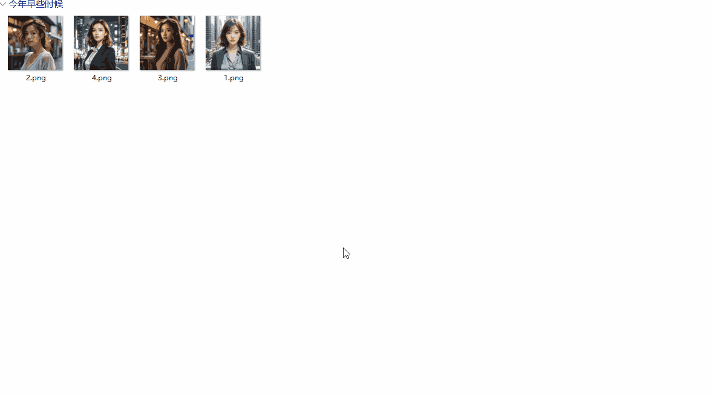

# 图片批量加水印

> 为图片添加文字或图片水印，支持平铺、旋转、九宫格定位，多图批量处理，可输出到指定目录或源图片目录。

---

## 核心特性

- **两种水印类型**：文字水印、图片水印（Logo）
- **文字水印可定制**：字体、字号、颜色、描边颜色与宽度；中文自动回退到系统 CJK 字体，不会出现方块
- **图片水印可缩放**：按原图宽度比例调整 Logo 大小
- **通用参数**：透明度、旋转角度（-180°~180°）、九宫格定位、平铺模式
- **实时预览**：缩略图快速切换，调整参数即时看到效果
- **多图批量**：一次性添加多张图片，点「确定添加水印」统一处理
- **输出位置可选**：留空则输出到各图源目录；也可指定统一输出目录
- **输出命名固定**：输出为 `原名_watermarked.png`（PNG 格式）
- **配置自动记忆**：水印参数与输出设置自动保存，下次打开沿用
- **离线可用**：界面与渲染全部本地完成，无任何外部依赖

---

## 脚本演示




---

## 安装方法

本脚本的运行环境、依赖组件及图形化窗口均依赖「不忙脚本盒子」，建议仅通过盒子安装和使用。

> 前置条件：安装好 [不忙脚本盒子](https://www.bm-box.cn)

* 打开盒子 → **脚本市场** → 搜索 **「图片加水印」**
* 点击「安装」，等待安装完成


---

## 使用方式

- **打开窗口**（任意方式都会弹出配置窗口）
  - 在盒子主界面点击「图片加水印」卡片
  - 在盒子「热键管理」为该脚本绑定快捷键后按下
  - 在文件夹中选中图片 → 右键 → 不忙脚本盒子 → 图片加水印

- **添加图片**（三选一，可混合）
  - 点「添加图片」：打开系统文件对话框，可多选（记住源目录）
  - 点「选择图片」：用系统文件选择器多选
  - 直接把图片拖进预览区

- **设置水印**
  - 选择「文字水印」或「图片水印」；文字可设置内容、字体、字号、颜色、描边；图片可「选择水印图片」并调整大小
  - 设置透明度、旋转角度、位置（九宫格）、是否平铺，右侧实时预览

- **输出**
  - **输出目录**：留空则保存到每张图片所在目录；也可点「浏览」指定统一目录
  - 输出文件名固定为 `原名_watermarked.png`
  - 点「确定添加水印」，逐张处理并显示进度

- **完成**
  - 全部成功：提示「已输出 N 张」，窗口自动关闭
  - 有失败：窗口保留并显示失败原因，便于调整后重试

---

## 🔗 作为节点被调用（脚本联动）

本脚本已声明为节点（`[bmscriptsbox.node] enabled = true`），可被其他脚本通过 `/api/link` 同步调用：不弹窗口、不等待输入，静默处理并把结果写入信封。

- **输入**：`target_paths`（图片路径数组）
- **运行参数**

  | 参数 | 类型 | 默认 | 说明 |
  | --- | --- | --- | --- |
  | `type` | str | text | 水印类型：`text` / `image` |
  | `text` | str | © BmScriptsBox | 文字水印内容 |
  | `font_size` | int | 48 | 字号（px） |
  | `color` | str | #ffffff | 文字颜色 |
  | `opacity` | float | 0.7 | 透明度（0.1~1） |
  | `rotation` | int | 0 | 旋转角度（-180~180） |
  | `position` | str | c | 九宫格位置 `nw/n/ne/w/c/e/sw/s/se` |
  | `tile` | bool | false | 是否平铺 |
  | `image_path` | str | 空 | 图片水印文件路径 |
  | `scale` | int | 20 | 图片水印占原图宽度百分比 |
  | `output_dir` | str | 空 | 输出目录；留空则输出到源目录 |
  | `suffix` | str | _watermarked | 输出文件名后缀 |

- **输出（信封）**

  | 键 | 类型 | 说明 |
  | --- | --- | --- |
  | `code` | int | 0 成功；非 0 失败 |
  | `msg` | str | 结果说明 |
  | `files` | list | 处理成功的输出文件路径列表 |
  | `count` | int | 处理成功的数量 |

调用示例（调用方脚本）：

```python
import json, sys, requests

env = json.load(open(sys.argv[1], encoding='utf-8'))['environment']
r = requests.post(f"{env['api_base']}/api/link", json={
    "script_id": "c8f3e2a1-3d4b-5c6d-7e8f-9a0b1c2d3e4f",   # 本脚本 id
    "data": {"target_paths": ["C:/a/photo.jpg"]},
    "params": {"type": "text", "text": "© MyApp", "position": "se", "output_dir": "C:/out"},
}, timeout=3600)

result = r.json()["result"]
if result.get("code") != 0:
    raise RuntimeError(result.get("msg"))
print(result["files"])   # 输出文件路径列表
```

> 修改 TOML 后需在盒子中**重新安装 / 更新**本脚本，节点声明才会生效。

---

## 💡 使用提示

- 通过右键/快捷键触发时，已在文件管理器中选中的图片会自动带入窗口。
- 拖拽添加的图片拿不到源目录，若「输出目录」留空将无法保存，请先指定输出目录。
- 选中的水印图片会被复制并统一转存为 PNG 到 `%USERPROFILE%\.image-marker\watermark.png`。
- 水印文字留空时**不绘制文字水印**（图片水印加载失败时会自动回退为默认文字）。
- 中文水印：渲染时若所选字体不含中文字形，会自动改用系统 CJK 字体（Microsoft YaHei / Noto Sans SC / SimHei / SimSun 等），不会出现方块。

---

## 🖥️ 环境要求

| 项目 | 要求 |
| --- | --- |
| **操作系统** | Windows 10 1803+（64 位） |
| **运行环境** | Node.js >= 16（盒子自动下载） |
| **外部工具** | webview-cli（盒子自动下载） |
| **运行依赖** | `@napi-rs/canvas`（盒子自动安装） |

---

## 更新日志

- v1.4.1（当前最新版）
  - 修复中文水印渲染成方块：渲染时按文本内容自动回退系统 CJK 字体
  - 修复水印图片与目标图的 Content-Type 与实际格式不符：水印图统一转存为 PNG，目标图按扩展名返回正确类型
  - 统一空文字水印语义：留空即不绘制（预览与输出一致）
  - 字体下拉新增中文选项（Microsoft YaHei / Noto Sans SC / SimHei / SimSun / Microsoft JhengHei）
  - 移除界面上的「文件名后缀」输入（固定 `_watermarked`，节点调用仍可用 `suffix` 参数）
